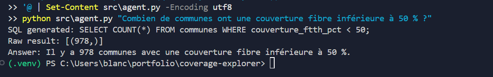
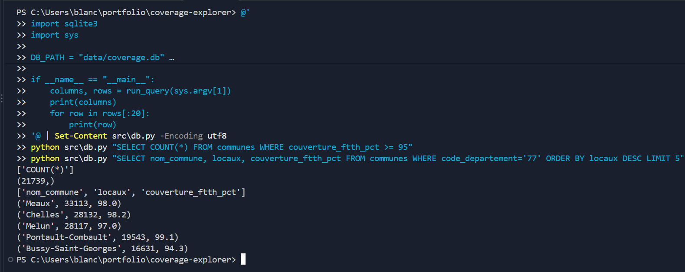
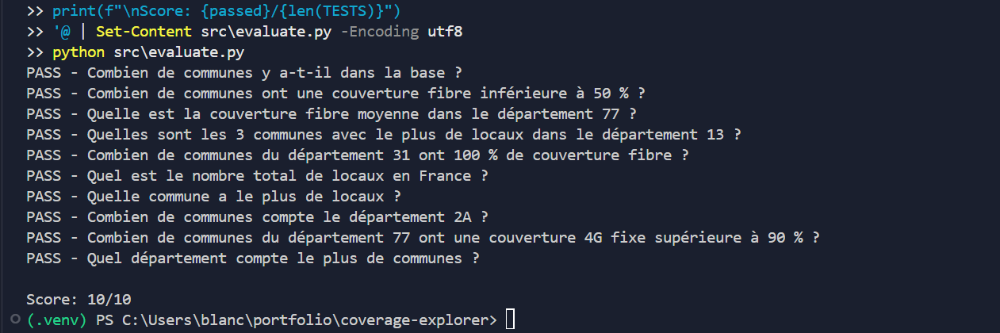
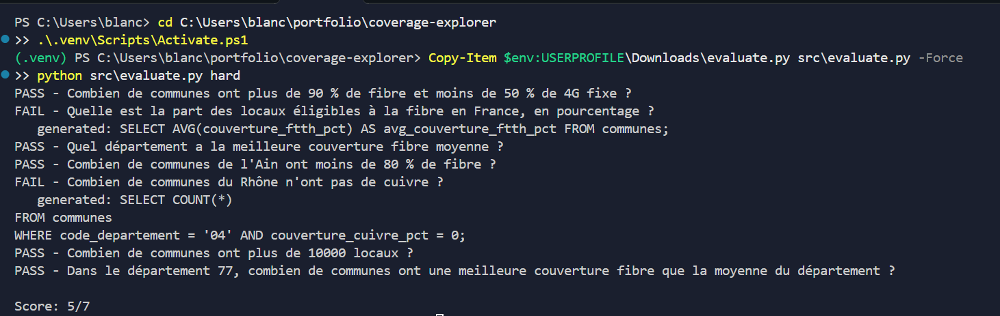
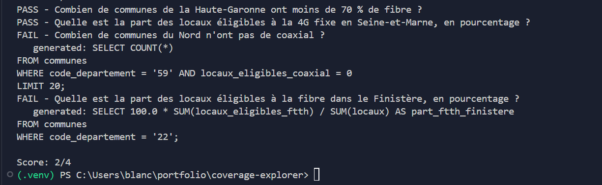
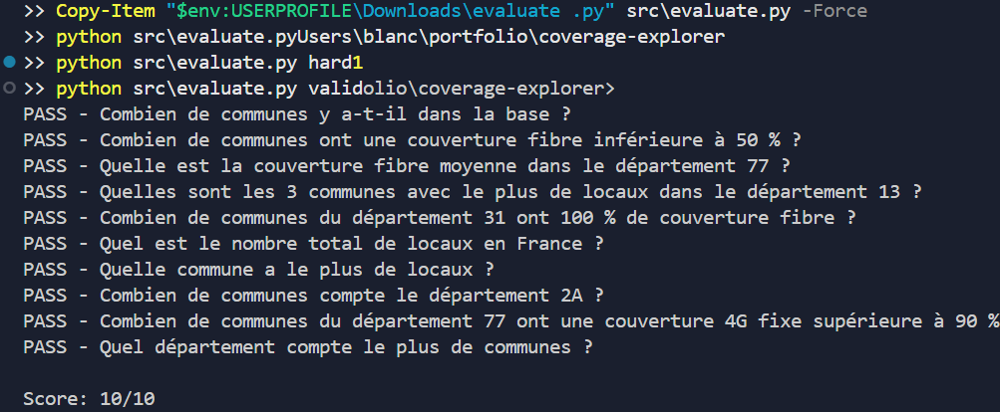
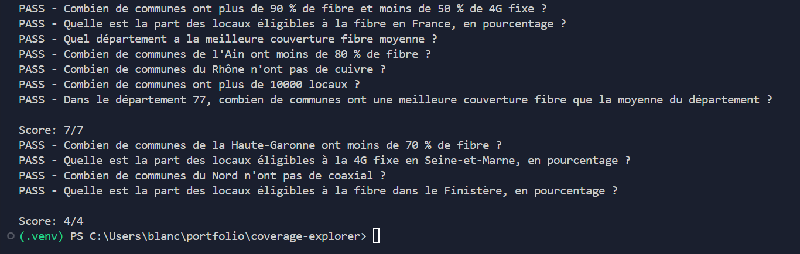

# Coverage Explorer

Ask questions in plain French about fibre and mobile coverage in France. A local language model turns each question into a SQL query, the query runs on open data from the French regulator ARCEP, and the answer comes back as a sentence.

**Status:** v1.0 (prototype)

## What this project shows

- Loading a public CSV (34,870 communes) into a SQLite database with Python and pandas
- A natural-language-to-SQL agent: question, SQL generation, execution, answer in French
- Running an open-source language model locally with Ollama (`qwen2.5-coder:7b`, no API key)
- A read-only query runner: only `SELECT` statements are accepted and the database is opened in read-only mode, so generated SQL cannot modify the data
- A test suite with hand-written reference queries to measure the quality of the answers, including the failures

## How it works

```
French question
      |
      v
add_department_note()   plain Python: "Rhone" -> code '69'
      |
      v
language model          writes one SELECT query (Ollama, qwen2.5-coder:7b)
      |
      v
run_query()             read-only execution on SQLite
      |
      v
language model          explains the result in one or two sentences
```

Example:

```
> python src\agent.py "Combien de communes ont une couverture fibre inférieure à 50 % ?"
SQL generated: SELECT COUNT(*) FROM communes WHERE couverture_ftth_pct < 50;
Raw result: [(978,)]
Answer: Il y a 978 communes avec une couverture fibre inférieure à 50 %.
```



## Data

[Couverture internet fixe par commune et par département (ARCEP)](https://www.data.gouv.fr/datasets/couverture-internet-fixe-par-commune-et-par-departement-agregation-arcep) on data.gouv.fr, published under the Licence Ouverte 2.0. One row per commune: number of premises and coverage by technology (fibre, cable, copper, fixed 4G, radio, satellite). Data date: 2026-03-31.

The data files are not stored in this repository. Download `communes.csv` and put it in `data/`.



## Run it

Requirements: Python 3, [Ollama](https://ollama.com), 16 GB of RAM recommended.

```powershell
python -m venv .venv
.\.venv\Scripts\Activate.ps1
pip install -r requirements.txt
ollama pull qwen2.5-coder:7b
python src\load_db.py          # builds data/coverage.db from data/communes.csv
python src\agent.py "Quelle commune a le plus de locaux ?"
```

## Evaluation

`src/evaluate.py` asks the agent a list of questions, runs the SQL it writes, and compares the result with a reference query written by hand. A question passes when the agent's result contains every value of the reference result.

```powershell
python src\evaluate.py          # 10 easy questions
python src\evaluate.py hard     # 7 harder questions
python src\evaluate.py valid    # 4 new questions
```

| Series | First run | After fixes |
|---|---|---|
| Easy (counts, averages, sorting) | 10/10 | 10/10 |
| Hard (several conditions, shares, department names) | 5/7 | 7/7 |
| New questions | 2/4 | 4/4 |





### What went wrong, and what I changed

1. **A share computed as an average of percentages.** For "the share of premises eligible to fibre in France", the model averaged the commune percentages, so a tiny village counted as much as Paris. I added a rule to the prompt: shares must be weighted by the number of premises.
2. **Wrong department codes.** The model answered `'76'` for the Rhône (it is `'69'`) and `'22'` for the Finistère (it is `'29'`), even with the list of codes in its prompt. A 7-billion-parameter model does not follow a long list reliably. I moved this job out of the model: `src/departments.py` finds department names in the question with plain code and adds a note with the right code before the model is called.
3. **A mistake in my own test.** For "communes without coaxial", the model used `locaux_eligibles_coaxial = 0` and my reference used `couverture_coaxial_pct = 0`. The two queries gave 597 and 601 communes: four communes have a few eligible premises but a coverage rounded to 0 %. The model's query was the more accurate one, so I corrected two references.




### Limits of this evaluation

- The test sets are small (21 questions in total).
- The "new questions" series was written before the department fix, but I looked at its failures and corrected two references afterwards, so the final 4/4 is not a clean held-out result.
- The comparison is lenient: it checks that the reference values appear in the agent's result, not that the query is the same.
- A better test would use more questions, written by someone else.

## Limits of the agent

- It queries one table only (communes), not the whole ARCEP and ANFR data.
- Small local models still make mistakes on unusual questions. The SQL is printed so the user can check it.
- Questions are about the situation at the data date, not about trends over time.

## Project structure

```
coverage-explorer/
├── data/            communes.csv and coverage.db (not in the repository)
├── docs/img/        screenshots used as proof
├── src/
│   ├── load_db.py       CSV -> SQLite
│   ├── db.py            read-only query runner
│   ├── departments.py   department names -> codes
│   ├── agent.py         question -> SQL -> answer
│   └── evaluate.py      test series with reference queries
├── requirements.txt
└── README.md
```
